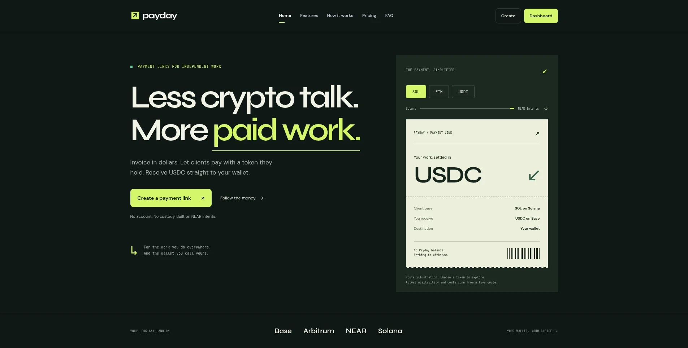
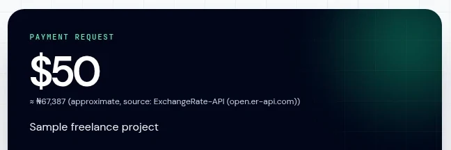
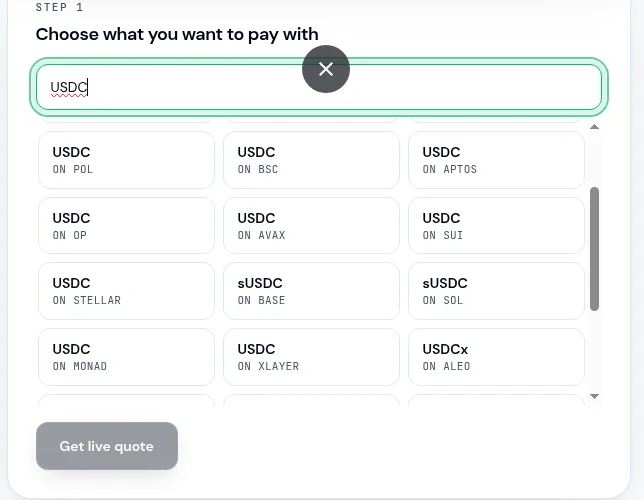
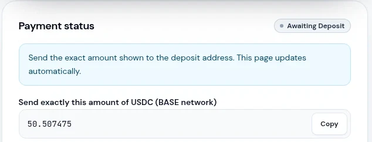
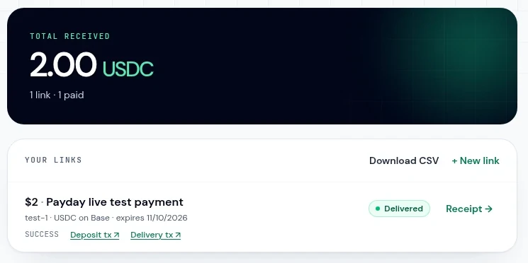
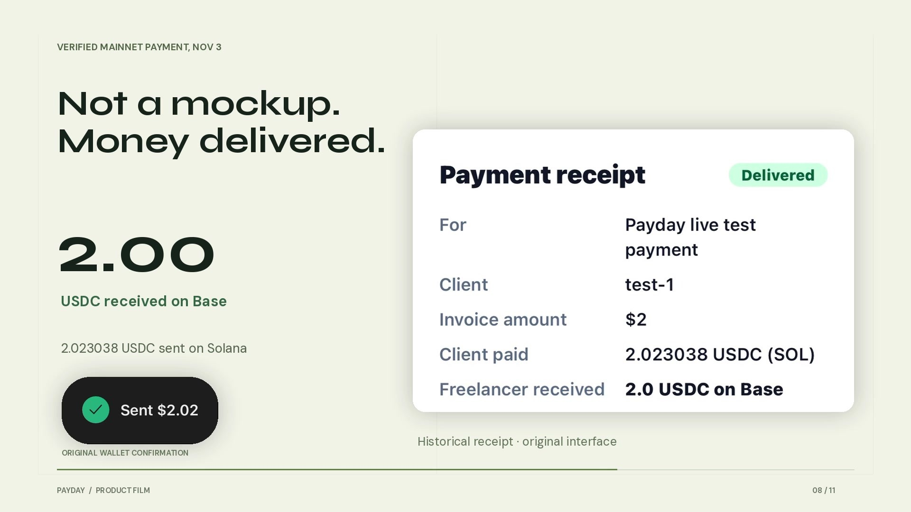
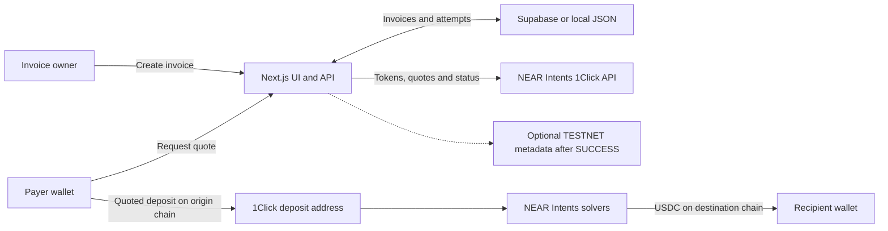

# Payday

USDC invoice links with cross-chain settlement through NEAR Intents 1Click.

**Live application:** [payday-near.vercel.app](https://payday-near.vercel.app)

**Networks:** mainnet payments; optional invoice metadata on NEAR **TESTNET**.

**Hackathon submission track:** Real-World Money (`realworld`). This is the submission category, not an award.

An invoice specifies a USD amount and a USDC receiving wallet. The payer selects a supported origin token and chain, requests an exact-output quote, and sends the quoted deposit from their own wallet. Payday tracks settlement and provides a receipt. Available routes and costs come from the live 1Click API; not every token or chain combination is supported.

## Demo

**X demo post: PENDING.** Add the published X post link here after publication. No demo-post URL is available yet.

These are application captures, not a live payment feed. The quote is a historical example, not a current offer or an instruction to send funds. Receiving/deposit addresses, private management URLs and credentials are excluded from the images.



| Payment request, with receiving address omitted | Token search |
| --- | --- |
|  |  |

**Quote details:** the deposit address and any payment destination instructions below the amount are cropped out.



**Dashboard:** historical test-invoice summary and CSV export controls. The private management URL and dashboard credential are not shown.



**Historical receipt:** this frame preserves the original interface. Its `2.023038 USDC` client-input figure is the older quoted amount, not the actual on-chain deposit. See the transaction evidence below.



## Historical mainnet payment

A payment on **3 November 2026** settled a **2.00 USDC** invoice from Solana to Base.

| Evidence | Amount | Source |
| --- | --- | --- |
| Confirmed Solana USDC transfer | **2.020567 USDC** | [Origin transaction on Solscan](https://solscan.io/tx/547PEU3gUVs6qXJiJCPDniw64XRb8TicPRcZiymfpoD4MkPLobvvQ8XCMzB4ewkEuNeATda5uwTpRMxLZ2WMj61W) |
| Successful Base USDC transfer from NEAR Intents treasury | **2.00 USDC** | [Destination transaction on BaseScan](https://basescan.org/tx/0x0aab97ebb1436917d556bf02139d193701f3a9a3f165c340e9e8759dc47db5cb) |

The Solana transfer was checked through a finalized, read-only transaction lookup; the Base explorer reports a successful transfer of 2,000,000 USDC base units. The screenshot's approximately `2.023 USDC` figure must not be presented as the amount actually sent. The distinction between quoted and deposited amounts is covered by [receipt amount tests](tests/amounts.test.ts). This is a historical payment, not a guarantee of execution time, fees or future route availability.

## Architecture



### Payment flow

1. `POST /api/links` validates the recipient, payout chain, invoice amount, expiry and optional line items. It stores an invoice and returns a public payment link plus a private dashboard credential.
2. The payment page loads `GET /api/tokens`. The payer selects an origin asset and supplies a refund address on that asset's chain.
3. `POST /api/links/:id/quote` calls 1Click with `EXACT_OUTPUT`, the invoice's destination USDC asset and integer base-unit amount. The response supplies the input amount, origin-chain deposit address and any required memo.
4. The payer transfers from their own wallet. A quote request does **not** transfer funds or authorize Payday to spend them.
5. `GET /api/attempts/:id` reads 1Click status. The UI polls, shows deposit/processing/refund states, and links to a receipt after `SUCCESS`. Status refresh marks the invoice paid only after 1Click reports success.
6. If configured, the server attempts a separate testnet metadata write after that success transition. Registry failure does not roll back or block payment settlement.

Implementation: [1Click client](src/lib/oneclick.ts), [payment lifecycle](src/lib/payments.ts), [status mapping](src/lib/status.ts), [payout-chain definitions](src/lib/chains.ts).

## Implemented features

- Public payment links with descriptions, optional client references and line items. Invoice validation supports $1 to $10,000, up to 20 line items and expiry from 1 to 30 days.
- USDC payout destinations: Base, Arbitrum, NEAR and Solana. Origin assets are discovered from 1Click rather than a hard-coded coverage claim.
- Searchable token selection, refund-address checks, exact-output quotes and deposit instructions.
- Polling-based payment status, expired-quote handling, underpayment/refund guidance and receipts with explorer links.
- Private dashboard with invoice/attempt history and authenticated CSV export.
- Machine-readable invoice and quote endpoints for agents using the same payment flow. This is not an autonomous wallet or a PingPay x402 integration.
- Optional NEAR testnet invoice fingerprints, described below.
- Approximate NGN display from ExchangeRate-API, for reference only and never used to calculate settlement.

Payday's platform fee is waived during the hackathon. This is not a permanent free-pricing commitment. Network, solver and withdrawal costs still apply and must be reviewed in the quote.

### API surface

| Method | Path | Purpose |
| --- | --- | --- |
| `POST` | `/api/links` | Create an invoice and return its dashboard credential |
| `GET` | `/api/links/:id` | Read the public payment-page view |
| `GET` | `/api/tokens` | Read available origin-token options |
| `POST` | `/api/links/:id/quote` | Request a quote and create a payment attempt |
| `GET` | `/api/attempts/:id` | Refresh/read attempt status |
| `GET` | `/api/invoices/:id` | Read the `payday.invoice.v1` agent view |
| `POST` | `/api/invoices/:id/pay` | Request a quote through the agent interface; does not send a payment |
| `GET` | `/api/dashboard` | Read the owner's dashboard using its bearer credential |
| `GET` | `/api/dashboard/export` | Export the owner's CSV using its bearer credential |

See [agent API documentation](docs/agent-payments.md) for request fields and the quote/deposit/poll sequence. Never publish dashboard credentials, quote deposit destinations or private management URLs in examples.

## NEAR invoice registry: TESTNET only

The deployed registry is [`payday-registry-1794060636.testnet`](https://testnet.nearblocks.io/address/payday-registry-1794060636.testnet). It records invoice metadata, holds no customer funds and is independent of mainnet 1Click settlement.

The production registry environment was configured on 7 November 2026. The relayer credential's matching testnet access key was verified using read-only account queries. **Production signing and an end-to-end production registry write remain unverified.** Deployed configuration is not evidence that a production transaction has executed.

The existing hook is **success-only**: it runs when a payment attempt transitions to `SUCCESS`. Creating an unpaid invoice does not create a registry record. Registry errors soft-fail, and testnet records are not mainnet payment proof. There is no mainnet registry claim.

See [registry setup and verification limitations](docs/testnet-registry.md) and [the server integration](src/lib/near-registry.ts). Operator demo tooling is separate from the application flow and is not automatically run by setup or tests.

## Stack and repository layout

| Layer | Implementation |
| --- | --- |
| Web application | Next.js 16.4.4 App Router, React 19.3, TypeScript |
| Styling and motion | Tailwind CSS 4, CSS, Motion |
| Settlement | NEAR Intents 1Click REST API |
| Persistence | Supabase/Postgres; local JSON adapter for development |
| Registry client | `near-api-js`, server-side testnet relayer |
| Tests | Vitest, React server-render regression tests, mocked service boundaries |
| Deployment | Vercel Git deployments |

- [`src/app`](src/app): marketing, payment, receipt and dashboard routes; route handlers under `api`.
- [`src/components`](src/components): invoice forms, token picker, payment flow and presentation.
- [`src/lib`](src/lib): validation, money/base-unit conversion, 1Click integration, storage and registry client.
- [`supabase/migrations`](supabase/migrations): application schema and optional invoice fields.
- [`contracts/invoice-registry`](contracts/invoice-registry): NEAR contract source. Contract compilation is separate from the web test/build commands below.
- [`tests`](tests): unit and render-contract coverage, including Supabase numeric-to-string normalization for payment amounts.

## Local development

Requirements: **Node.js 20.9 or newer** and npm. Use a Node release supported by the installed Next.js version and your deployment platform.

```sh
git clone https://github.com/faze39/payday.git
cd payday
npm ci
cp .env.example .env.local
npm run dev
```

Open `http://localhost:3000`. No credentials are required for the local JSON store or public 1Click catalog. With Supabase unset, development data is written to `.data/payday-dev.json`.

**Local development still calls mainnet payment services.** The registry's testnet setting does not switch payment routing to testnet. Do not send funds unless deliberately testing a real payment with wallets you control.

### Environment variables

Use [`.env.example`](.env.example) as the template. The table lists names and purposes only; keep real values out of documentation and version control.

| Name | Purpose |
| --- | --- |
| `ONECLICK_API_KEY` | Optional server-side 1Click partner credential sent as `X-API-Key` |
| `ONECLICK_BASE_URL` | Optional server-side override of the 1Click API endpoint |
| `SUPABASE_URL` | Database project endpoint; configure with the service-role credential for persistent deployments |
| `SUPABASE_SERVICE_ROLE_KEY` | Server-only database credential; never expose to the browser |
| `NEXT_PUBLIC_APP_URL` | Public canonical application URL used in agent invoice links |
| `NEAR_INVOICE_CONTRACT_ID` | Deployed testnet registry account for optional metadata writes |
| `NEAR_RELAYER_ACCOUNT_ID` | Testnet signer authorized by the registry contract |
| `NEAR_RELAYER_KEY` | Server-only testnet signing key; store as a sensitive production secret |
| `NEAR_NETWORK` | Registry network selector; this integration accepts testnet only |

Registry writes stay disabled until the contract, relayer account and key are all configured. There is no customer-wallet signing key in the application configuration.

### Persistent deployment

1. Provision Supabase and apply these migrations in order:
   - [`0001_init.sql`](supabase/migrations/0001_init.sql)
   - [`0002_line_items.sql`](supabase/migrations/0002_line_items.sql)
   - [`0003_near_record.sql`](supabase/migrations/0003_near_record.sql)
2. Configure the database variables as server-side deployment secrets. Set the public application URL separately.
3. Optionally configure the testnet registry variables. Keep its key sensitive and production-scoped; do not copy it into a public variable or repository file.
4. Run checks, then deploy through the connected Vercel Git project.

The JSON adapter is not production storage. Without Supabase, Vercel falls back to transient local storage; it does not provide durable invoice history.

## Development checks

```sh
npm test              # Vitest unit and render-contract tests
npm run typecheck     # TypeScript checks
npm run lint          # ESLint
npm run build         # Next.js production build
npm start             # Serve the built application locally
```

The web test suite mocks external payment and registry services; passing tests does not prove an on-chain transfer or production relayer signing. Browser hydration, quote submission and funded settlement require separate, deliberately authorized runtime verification.

## Security and operational limitations

- Payday does not hold customer funds or customer wallet keys. The optional relayer holds only its own testnet signing key for metadata transactions.
- Public invoice IDs expose the invoice description, reference and receiving address. Do not store sensitive client information in those fields.
- Dashboard access is a bearer-secret link, not a full account system. Anyone holding it can access that owner's records. Only its hash is stored in the backend; keep the original credential private.
- Supabase access is server-side using the service-role credential. Row-level security is enabled without public access policies in the supplied schema.
- Address validation checks syntax, not ownership or control. Confirm the asset, network, destination and any memo before sending.
- The app polls rather than receiving payment webhooks. A page reload or dashboard refresh may be needed to observe a completed payment.
- Refunds, solver execution and chain availability depend on 1Click and its underlying networks. Quote amounts, fees and timing vary.
- NGN conversion is approximate and informational. It is not an FX guarantee or settlement asset.

## License

[MIT](LICENSE), as specified in the repository's license file.
