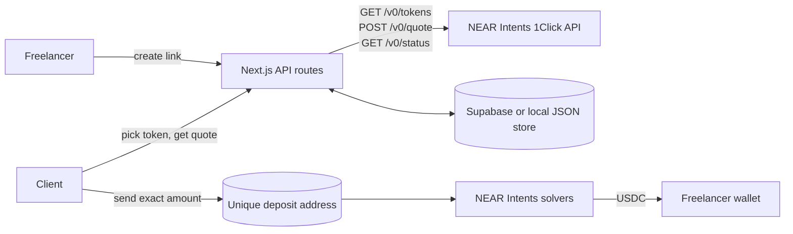

# Payday

**Get paid in USDC by anyone, from any token on any chain, with one link.**

> Status: live on mainnet at [payday-near.vercel.app](https://payday-near.vercel.app) (NEAR Hackathon, Nov 2026). Link creation, live quotes, status tracking, the receipt and the dashboard all work against the 1Click API. First real payment verified on 2026-11-03: 2.020567 USDC on Solana deposited, exactly 2.00 USDC delivered on Base (~20s); excess auto-refunded.

## The problem
I'm a Nigerian freelance writer. International clients pay me in whatever they hold: USDT on Tron, ETH on Arbitrum, SOL. Every invoice turns into a conversation about which coin and which network. Mistakes cost money, bridges and middlemen take a cut, and confused clients put off paying.

## How it works
1. **The freelancer** enters a receiving wallet, the amount in USD and a description, and gets a link.
2. **The client** opens the link, picks any token they hold (215 tokens across 38 chains, loaded live), enters a refund address, and gets a live quote with a unique deposit address and the exact amount to send.
3. **NEAR Intents** (1Click API) detects the deposit, swaps and bridges it, and delivers the exact USDC amount to the freelancer's wallet.
4. **The status page** updates on its own (awaiting deposit → swapping → delivered) and ends with a receipt that has explorer links for both transactions.

Payday never holds funds or keys. It only asks 1Click for quotes and reads status.



## How NEAR Intents is used (judge's quick guide)
| What | Where |
| --- | --- |
| 1Click client (tokens, quote, status, optional `X-API-Key`) | [`src/lib/oneclick.ts`](src/lib/oneclick.ts) |
| Quote request: `EXACT_OUTPUT`, so the freelancer gets the exact invoice amount | `buildQuoteRequest` in `src/lib/oneclick.ts` |
| Creating a payment attempt from a real quote, refreshing status, marking a link paid | [`src/lib/payments.ts`](src/lib/payments.ts) |
| 1Click status → user-facing state and guidance | [`src/lib/status.ts`](src/lib/status.ts) |
| Payout chains (verified against `/v0/tokens` and a dry quote) | [`src/lib/chains.ts`](src/lib/chains.ts) |
| Tests | [`tests/`](tests) |

Supported payout chains: **Base (default), Arbitrum, NEAR, Solana**. On 2026-11-03 the dry quotes showed withdrawal fees of about $0.002 (Base), about $0.005 (Arbitrum and NEAR) and about $0.25 (Solana).

## Run it in 5 minutes
Requires Node.js 20 or later.
```bash
git clone https://github.com/faze39/payday && cd payday
npm install
npm run dev        # http://localhost:3000
```
No accounts or keys are needed for local use. The app calls the public 1Click API and stores data in `.data/payday-dev.json`.

```bash
npm test           # unit tests (Vitest)
npm run build      # production build
```

### Environment variables (see `.env.example`)
| Variable | Required | Purpose |
| --- | --- | --- |
| `ONECLICK_API_KEY` | No | 1Click partner JWT, sent as `X-API-Key` for the lower partner fee |
| `SUPABASE_URL` | For deploys | Supabase project URL |
| `SUPABASE_SERVICE_ROLE_KEY` | For deploys | Server-only key. Never commit it. |
| `NEAR_INVOICE_CONTRACT_ID` | Optional | Deployed invoice-registry account id |
| `NEAR_RELAYER_ACCOUNT_ID` | Optional | Account that signs `record_invoice` |
| `NEAR_RELAYER_KEY` | Optional | `ed25519:…` secret for the relayer (Vercel only) |
| `NEAR_NETWORK` | Optional | `mainnet` (default) or `testnet` |
| `NEXT_PUBLIC_APP_URL` | Optional | Canonical site URL for agent invoice links |

### Production (Vercel + Supabase)
1. Create a Supabase project and run [`supabase/migrations/0001_init.sql`](supabase/migrations/0001_init.sql) in its SQL editor.
2. Import the repo in Vercel and set the environment variables above.
3. Deploy.

## Handling failures
- **Quote older than 30 minutes:** the deposit address is hidden and the client is asked to get a new quote. A payment already sent is still tracked.
- **Underpaid** (`INCOMPLETE_DEPOSIT`): the client is told to top up or wait for the automatic refund.
- **Refunded or failed:** the page shows the refunded amount, the reason, and a "try again" button.
- **Overpaid:** 1Click refunds the excess to the client's refund address.

## Known limitations
- Address checks only test the format. They can't prove that the freelancer controls the address.
- The dashboard is secured by a secret link (only a hash of its token is stored), not by a full login.
- Status updates come from polling (every 5 s on open pages, and on each dashboard load), not webhooks.
- The naira figure is an approximate mid-market rate from open.er-api.com, for display only.

## Features (branch `features-v2`)
- **CSV export** from the dashboard (`GET /api/dashboard/export`) with 1Click statuses (`SUCCESS`, `REFUNDED`, `INCOMPLETE_DEPOSIT`, …) and explorer tx links.
- **Line-item invoices** (optional). Stored in `payment_links.line_items` — run `supabase/migrations/0002_line_items.sql`.
- **NEAR invoice registry** (scaffold): `contracts/invoice-registry` records fingerprints only; wire with `NEAR_INVOICE_CONTRACT_ID` + relayer env after you deploy. See that folder's README. Migration: `0003_near_record.sql`.
- **AI agent payments**: `GET /api/invoices/:id` and `POST /api/invoices/:id/pay` on the existing 1Click flow. See [`docs/agent-payments.md`](docs/agent-payments.md). PingPay x402 is cited there but **not** integrated (no Ping API key).

## What's next
Demo video and X post for the hackathon submission. Optional later: an invoice agent, webhook-based status, and wallet connect for one-click client payments.

## License
MIT
